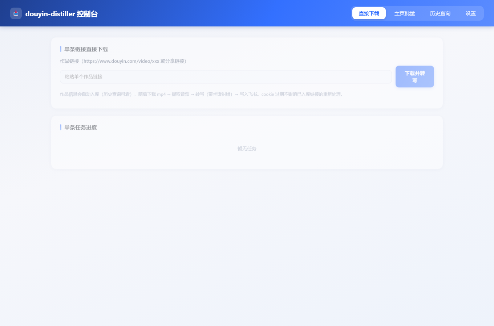

# 📥 douyin-distiller

> 抖音博主主页 → 批量采集 → 下载 mp4 → 语音转写（ASR）→ 文本纠错 → 写入飞书多维表
> 一套带 Web 界面的「抖音视频 → 结构化文本」自动化流水线。

[English](README.en.md) · [日本語](README.ja.md) · [한국어](README.ko.md)

---

## 🖼 界面预览



---

## ✨ 特色与亮点

- **一条龙自动化**：输入博主主页或单条视频链接，自动完成 **采集 → 下载 → 提取音频 → 语音转写 → 术语纠错 → 写入飞书多维表**，全程 Web 可视化。
- **本地优先、可离线**：视频、音频、逐字稿全部落本地（SQLite + 文件），支持历史查询与重跑，cookie 过期也不影响已入库作品的再次处理。
- **三通道 ASR**：本地 Whisper（faster-whisper）／讯飞语音听写／飞书语音识别，页面可切换，默认本地，无需外发敏感音频。
- **LLM 智能纠错**：转写后经 LLM（阿里 qwen-max 或本地 vLLM）补标点 + 纠正农业/专业同音字，输出可直接交付的成稿。
- **单链接 / 主页批量双入口**：批量支持「顺序 / 随机」，先采集全部作品链接入库，再逐个稳定处理。
- **数据库持久化**：所有作品与设置存 SQLite（videos 表 + settings 表），页面设置即时生效，重启不丢。
- **条件查询 + 按需导出**：历史页支持状态／来源／作者／发布日期范围／时长／关键词筛选，导出**只导出当前筛选结果**（CSV，Excel 直开不乱码）。
- **历史记录可重跑 / 可删**：每条作品提供「重转写」（用本地音频，无需 cookie）／「重下载」（需 cookie）／「删除」（连本地视频音频一并清掉）。
- **批量自动过滤直播类**：主页批量采集时自动跳过标题含「直播回顾 / 直播预告 / 直播开始 / 直播回放」的作品（可用 `douyin.skip_titles` 配置）。
- **本地视频/音频可访问**：`/data` 静态挂载，页面一键查看、播放、下载。
- **飞书多维表深度集成**：字段自动创建，写入按 aweme_id **upsert**（存在更新、不存在新建），已存在作品会覆盖为最新文本，杜绝重复。
- **易部署**：原生 `venv + systemd` 或 `Docker / docker-compose` 一键启动，配置集中于单个 `settings.json`。

---

## 📦 功能特性

| 能力 | 说明 |
|---|---|
| 单链接下载 | 粘贴单条作品链接 → 下载 → 转写 → 入库 → 写飞书 |
| 主页批量 | 输入博主主页 → 采集全部作品链接入库 → 顺序/随机逐个下载转写 |
| 历史查询 | 状态/来源/作者/发布日期/时长/关键词多条件组合查询 |
| 历史重跑 | 每条可「重转写」（本地音频，无需 cookie）或「重下载」（需 cookie） |
| 记录删除 | 删除记录及本地视频/音频文件（确认后不可恢复） |
| 批量过滤 | 自动跳过直播回顾/预告/开始/回放类作品（可配置 douyin.skip_titles） |
| 按条件导出 | 导出当前筛选结果的 CSV（UTF-8 BOM，Excel 直开） |
| 语音转写 | 本地 Whisper / 讯飞 / 飞书三通道可切换 |
| 术语纠错 | LLM 补标点 + 纠正专业同音字（内置水稻/农业术语词表） |
| 飞书写入 | 自动建字段，aweme_id 去重 + upsert 更新 |
| 设置管理 | 所有配置存数据库 settings 表，页面保存即时生效 |
| 本地存储 | mp4 / mp3 / 逐字稿全部本地持久化，可访问可下载 |

---

## 🏗 架构

```
                        ┌──────────────────────────────────────┐
   博主主页/单链接       │           douyin-distiller (Web)        │
  ────────────────▶    │                                          │
                        │  采集(f2) → 下载(mp4) → ffmpeg提取音频(mp3) │
                        │          → ASR转写 → LLM纠错              │
                        │          → SQLite入库 → 写飞书多维表       │
                        │                                          │
                        └─────────────┬──────────────┬────────────┘
                                      │              │
                             ┌────────▼────┐  ┌──────▼────────┐
                             │ ASR 服务     │  │ LLM 纠错服务   │
                             │ whisper 8003 │  │ qwen-max/本地  │
                             └─────────────┘  └───────────────┘
```

**模块**
- `app.py` — FastAPI 主程序：Web 页面 + REST API
- `worker.py` — 流水线编排（单链接 / 批量 / 进度管理）
- `f2_worker.py` — F2 封装：主页采集、单条详情、下载
- `asr_client.py` — 三通道语音转写 + LLM 标点/术语纠错
- `lark_client.py` — 飞书多维表读写（鉴权、建字段、upsert）
- `db.py` — SQLite：videos 表（作品记录） + settings 表（配置）
- `config.py` — 配置读写（数据库优先，settings.json 作初始种子）

---

## 🚀 快速开始

### 方式一：Docker（推荐）

```bash
# 1. 拉取/构建并准备配置
git clone https://github.com/<you>/douyin-distiller.git
cd douyin-distiller
cp settings.example.json settings.json   # 编辑：填入 cookie / 飞书 / LLM 等
cp .env.example .env

# 2. 启动
docker compose up -d --build

# 3. 访问
# http://<host>:9009
```

### 方式二：原生 venv + systemd

```bash
git clone https://github.com/<you>/douyin-distiller.git
cd douyin-distiller
python3 -m venv .venv && source .venv/bin/activate
pip install -r requirements.txt
# 系统需安装 ffmpeg（Ubuntu: sudo apt install ffmpeg）
cp settings.example.json settings.json

# 启动
uvicorn app:app --host 0.0.0.0 --port 9009
```

systemd 示例（`/etc/systemd/system/douyin-distiller.service`）：

```ini
[Unit]
Description=douyin-distiller
After=network.target

[Service]
User=ubuntu
WorkingDirectory=/opt/douyin-web
ExecStart=/opt/douyin-web/.venv/bin/uvicorn app:app --host 0.0.0.0 --port 9009
Restart=always

[Install]
WantedBy=multi-user.target
```

```bash
sudo systemctl daemon-reload
sudo systemctl enable --now douyin-distiller
```

---

## ⚙️ 配置（settings.json / 页面「设置」Tab）

> 所有配置也存数据库 settings 表，页面保存即时生效。敏感项（cookie、密钥）请勿提交 git。

| 配置段 | 关键项 | 说明 |
|---|---|---|
| `douyin.cookie` | 登录态 cookie | 采集/下载必需；从浏览器登录 douyin.com 抓取 |
| `asr.engine` | local / xfyun / feishu | 语音转写通道 |
| `asr.local.url` | whisper 端点 | 如 `http://<host>:8003/v1/audio/transcriptions` |
| `asr.xfyun.*` | app_id/api_key/api_secret | 讯飞语音听写 |
| `asr.feishu.*` | app_id/app_secret/api_endpoint | 飞书语音识别 |
| `feishu_table.*` | app_id/app_secret/base_token/table_id | 飞书多维表写入目标 |
| `llm.*` | base_url/model/api_key | 转写纠错模型（阿里 qwen-max 或本地 vLLM） |
| `server.base_url` | 外网可访问地址 | 用于生成本地视频/音频的下载链接 |

---

## 🧩 使用流程

1. **直接下载**：粘贴单条视频链接 → 下载并转写 → 自动入库 + 写飞书。
2. **主页批量**：粘贴博主主页 → 选「顺序 / 随机」→ 采集全部作品链接入库 → 逐个下载转写（直播回顾/预告类自动跳过）。
3. **历史查询**：多条件筛选，查看视频/音频/逐字稿；每条可「重转写 / 重下载 / 删除」；点击「导出当前结果」下载 CSV。
4. **设置**：录入 cookie、ASR 通道、飞书、LLM。

> **飞书多维表权限三件套（官方要求）**：① 开通应用身份 `bitable:app` 权限 → ② 发布应用版本 → ③ 把应用添加为该多维表协作者并授予「可管理」。否则写入报 91403 Forbidden。`wiki` 链接的 `wiki_token` 可直接当 `base_token` 使用。

---

## 🔌 API 一览

| 方法 | 路径 | 说明 |
|---|---|---|
| POST | `/api/task` | 主页批量（body: `{"url","order":"order|random"}`） |
| POST | `/api/download_single` | 单链接下载（body: `{"url"}`） |
| POST | `/api/reprocess` | 重试（body: `{"aweme_id","mode":"transcribe|download"}`） |
| DELETE | `/api/video/{aweme_id}` | 删除记录（`?delete_files=1` 连本地文件一起删） |
| GET | `/api/tasks` | 全部任务实时进度 |
| GET | `/api/videos` | 历史查询（status/source/author/q/date_from/date_to/min_duration/max_duration/limit/offset） |
| GET | `/api/export` | 按当前查询条件导出 CSV |
| GET | `/api/settings` | 读取全部配置 |
| POST | `/api/settings` | 保存配置（body: `{"values":{"douyin.cookie":"...",...}}`） |
| GET | `/api/health` | 健康检查 |

---

## ❓ FAQ

**Q: cookie 过期了还能处理吗？**
已入库的作品链接、本地视频、音频、逐字稿都在数据库和磁盘上，仍可查询、导出、播放，无需 cookie。

**Q: 转写文字有同音字错误？**
内置 LLM 纠错（默认阿里 qwen-max，也可用本地 vLLM），自动补标点 + 纠正专业术语同音字；纠错失败会保留原文不阻塞。

**Q: 多模态/文本 LLM 可共用？**
纠错走 OpenAI 兼容端点，本地 vLLM 或云端模型均可，只需在设置里填 base_url/model/api_key。

**Q: 视频/音频存在哪？**
`download.root`（默认 `/opt/douyin-web/data`）按任务建子目录，页面通过 `/data/...` 访问。

**Q: 某条没有逐字稿，为什么？**
多为短视频预告/直播回顾（无配音），whisper 转不出文字，状态标「无语音」；可在历史页点「重转写」复核，或「删除」清理。

**Q: 批量采集会碰到很多直播/预告吗？**
已默认自动跳过标题含「直播回顾 / 直播预告 / 直播开始 / 直播回放」的作品，如需自定义在设置里配 `douyin.skip_titles`。

---

## 🛣 路线图

- [x] 单链接 / 主页批量采集下载
- [x] 三通道 ASR + LLM 术语纠错
- [x] SQLite 持久化 + 设置入库
- [x] 条件查询 + 按需导出 CSV
- [x] 历史记录重转写 / 重下载 / 删除
- [x] 批量自动过滤直播类作品
- [x] 飞书多维表 upsert 写入
- [x] Docker / systemd 部署
- [ ] 互动统计（点赞/评论）补齐
- [ ] 转写结果增量/定时重跑
- [ ] Webhook / OpenAPI 对外接口鉴权
- [ ] 多语言 README 完善（欢迎 PR）

---

## 🤝 贡献与许可

欢迎提交 Issue / PR。请确保：不改动现有数据库结构以外的破坏性变更；敏感配置不提交；每项功能附带测试。
本项目基于 [MIT](LICENSE) 许可，兼容开源生态。

**免责声明**：请仅在遵守抖音平台规则与当地法律法规的前提下使用，用于合法内容处理。
